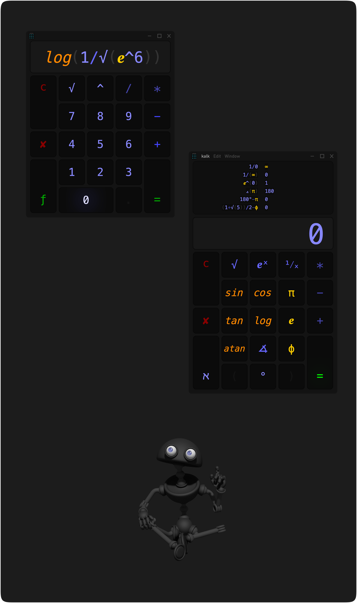

#### How to build the app on a mac

Install build dependencies [node](https://nodejs.org) and [zig](https://ziglang.org/) via [brew](https://brew.sh/), 
clone the repository, build and run the app:

```
/bin/bash -c "$(curl -fsSL https://raw.githubusercontent.com/Homebrew/install/HEAD/install.sh)"
brew install node zig

git clone https://github.com/monsterkodi/kalk.git

cd ./kalk/kalk.app

./kk -bkr
```

#### How to build the app on linux

The linux host is native C++ in `src/linux/`, built with the same
[zig](https://ziglang.org/) `c++` command as the mac app. It uses
[GTK 3](https://gtk.org/) and [WebKitGTK 4.1](https://webkitgtk.org/), the
same WebKit engine family as the mac WebView. There is no bundled browser.

Install the build dependencies once:

```
sudo dnf install webkit2gtk4.1-devel gtk3-devel json-glib-devel
```

Install zig (for example with `mise use zig`, `brew`, or your package
manager), then:

```
cd ./kalk/kalk.app
./kk -b
./kk -r
```

A prebuilt linux binary is included; `./run` starts it, and `pnpm start`
calls `./run`. Rebuild after changing `src/linux/` with `./kk -b`.

The app runs under x11 (xwayland) with `GDK_BACKEND=x11`; native wayland
does not let the app position and restore its own window. `GDK_SCALE`
defaults to 2 so the calculator is readable on this display; set
`KALK_GDK_SCALE` to override it. On hyprland the window floats through this
rule in `~/.config/hypr/apps.lua`:

```lua
o.window("(?i)^kalk$", {
  float = true,
})
```

The tray status item, titlebar dragging and the development hot-reload
watcher from the mac app are not ported. The window still positions,
resizes, restores from its stash and expands its sheet natively.

`pnpm test:native` runs the tests for the linux fs routes.

